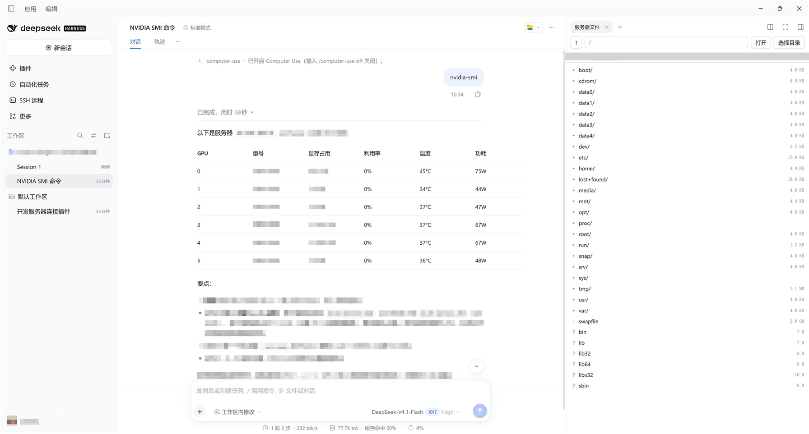

# dsh-plugin-ssh

[](https://github.com/JeremyLyc/dsh-plugin-ssh/stargazers)
[](LICENSE)
[](https://github.com/deepseek-ai/deepseek-harness)

**把一台远端 Linux 服务器变成 DeepSeek Harness 里的"工作区"**：agent 用对话操作服务器，你在侧栏里浏览它的目录、传文件、切换工作目录。

> SSH remote workspaces for [DeepSeek Harness](https://github.com/deepseek-ai/deepseek-harness). One plugin gives you
> workspace-scoped agent tools (`ssh_exec` / `ssh_upload` / `ssh_download`), a sidebar panel, a server-files tab, a workspace bound to a remote
> directory, and a composer pill showing where the agent is actually working.

---

## 这个插件做什么

DSH 的工作区必须是一个**真实存在的本地目录**，而 agent 真正要干活的是远端服务器。这个插件在两者之间架一座桥：

```
          ┌─────────────────────────── DSH Host 进程 ───────────────────────────┐
          │                                                                     │
  浏览器  │  lib/index.js  ── HTTP /ssh-panel/api/* ──►  lib/ssh.js  ── ssh2 ──► 服务器
 （面板） │       │                                         ▲                    │
          │       └─ 写绑定 + AGENTS.md                      │                    │
          │                                                 │                    │
          │  lib/tools.js（原生工具，按工作区绑定取主机）─────┘                    │
          └─────────────────────────────────────────────────────────────────────┘
```

- **会话工具**：`ssh_exec` / `ssh_upload` / `ssh_download` / `ssh_workspace`，模型直接调用。
  **工具不接受 host 参数**——主机由会话所在工作区的绑定决定，见下面的「隔离」一节。
- **左侧栏 `SSH 远程` 面板**：选主机、跑命令、传文件、一键建远程工作区。
- **右侧栏「服务器文件」页签**：浏览服务器任意目录、预览文本、切换工作目录。
- **远程工作区**：本地占位目录 + `.dsh-ssh-workspace.json` 绑定 + 自动生成的 `AGENTS.md`，
  该工作区里的每个会话都确切知道"我在哪台机器、在哪个目录、用哪个工具"。
- **密码弹窗**：主机没有预置密钥/密码时才问，密码只活在 Host 进程内存里。
- **输入框下方的当前目录 pill**：`prod:/srv/app` 或本地工作区路径，切目录即时跟随。

## 隔离：一个会话只能碰到自己的服务器

同时连多台服务器时，最容易出的事故是"这台机器的对话跑到那台机器上执行"。这个插件在
**工具契约层面**堵死它，而不是靠提示词提醒：

- 工具签名里**没有 `host` 参数**，也没有 `defaultHost` 兜底 —— 模型的调用在语法上就无法指向别的机器；
- 每次调用由 `exec.agent` 取当前 Session 的工作目录，读该目录下的 `.dsh-ssh-workspace.json`；
- 未绑定（普通工作区）→ 直接拒绝，连 `ssh_workspace` 都只回报"未绑定"；
- 绑定指向配置里不存在的主机 → 拒绝，不会回退到默认主机。

为什么不走 MCP：`dsh-mcp-client` 调 `client.callTool()` 时只转发工具名和参数，MCP 服务端
**拿不到会话身份**，只能接受任意 host 别名——那正是要避免的。原生工具能拿到 `exec.agent`，
所以隔离做在原生工具上。仓库里的 `server.mjs` 仍保留作参考/兼容实现，但**不要和原生工具同时启用**，
否则 MCP 那条路径会绕过隔离。


## 截图



## 安装

前置：DSH 桌面版（profile 目录 `~/.dsh/profiles/desktop`）、Node.js 20+。

```bash
# 1. 放进插件目录
git clone https://github.com/JeremyLyc/dsh-plugin-ssh ~/.dsh/plugins/dsh-plugin-ssh
cd ~/.dsh/plugins/dsh-plugin-ssh && npm install --omit=dev

# 2. 让 profile 能解析这个包
cd ~/.dsh/profiles/desktop
pnpm add "link:$HOME/.dsh/plugins/dsh-plugin-ssh" --ignore-scripts
```

3. 面板部分走包自带的 bundle 补丁：把包名加进 `dsh.profile.bundles`（`package.json` 里的
   `dsh.bundle.patch` 指向 `cordis.patch.yml`，它会插入 `ssh-panel` 条目）：

```json
{
  "dsh": {
    "profile": {
      "bundles": ["@deepseek-ai/dsh-base", "@deepseek-ai/dsh-web-app", "dsh-plugin-ssh"]
    }
  }
}
```

4. 就这些。`cordis.patch.yml` 里的 `ssh-panel` 条目同时注册面板接口和四个会话工具；
   日志出现 `ssh-panel: workspace-scoped tools registered (…)` 与
   `ssh-panel: endpoints registered at /ssh-panel/api` 即就绪。客户端 bundle 改动需要刷新窗口。

> 不要另外启用 `server.mjs` 的 MCP 条目：MCP 服务端看不到会话身份，会让一个会话碰到别的服务器。

## 配置主机

`~/.dsh/ssh-hosts.json`（可用 `DSH_SSH_HOSTS` 指定路径），会与你的 `~/.ssh/config` 合并：

```json
{
  "defaultHost": "prod",
  "hosts": {
    "prod": {
      "host": "10.0.0.10",
      "port": 22,
      "username": "deploy",
      "privateKeyPath": "~/.ssh/id_ed25519",
      "remoteRoot": "/srv/app"
    },
    "legacy": {
      "host": "10.0.0.11",
      "username": "ops",
      "password": "${LEGACY_SSH_PASSWORD}"
    }
  }
}
```

| 字段 | 说明 |
|---|---|
| `host` / `port` / `username` | 连接目标，`username` 也可写 `user` |
| `privateKeyPath` | 私钥路径，支持 `~`；不填且没密码时回退 `id_ed25519` → `id_rsa` → `id_ecdsa` |
| `password` / `passphrase` | 密码 / 私钥口令；支持 `${ENV}`，未设置的环境变量按"没有"处理 |
| `hostKeySha256` | 钉住主机指纹（`SHA256:...`），填了就严格校验 |
| `strictHostKey` | `true` 时拒绝未钉住指纹的主机 |
| `connectTimeoutMs` | 连接超时，默认 10000 |

**密码策略**：配置里有密钥或密码 → 连接时不再询问；都没有 → 面板弹密码框，密码只存在
Host 进程内存（`setRuntimePassword`），**不写任何文件**，DSH 重启后重新问。

## 工具

| 工具 | 作用 |
|---|---|
| `ssh_exec` | 在**本工作区绑定的主机**上执行命令，返回 stdout/stderr/退出码，`workdir`/`timeoutMs` 可选 |
| `ssh_upload` | 本地文件 → 绑定主机（SFTP，自动建父目录） |
| `ssh_download` | 绑定主机文件 → 本地（SFTP） |
| `ssh_workspace` | 回报当前工作区绑定的主机、登录目录与远端工作目录 |

四个工具都**没有 host 参数**：目标主机只来自工作区绑定，`ssh-hosts.json` 里其它服务器对模型不可见。

非零退出码以 `[exit code: N]` 返回，不算工具错误；超时会向远端发 `KILL` 并标 `[timed out after Nms]`。

## HTTP 端点

全部 `kind: exact`，只接受本机/渲染进程请求，且拒绝来自非回环地址的调用：

| 方法 | 路径 | 作用 |
|---|---|---|
| GET | `/ssh-panel/api/hosts` | 主机列表与告警 |
| POST | `/ssh-panel/api/connect` | `{host, password?}` → 验连；缺凭据回 `needsPassword` |
| POST | `/ssh-panel/api/exec` | 执行命令 |
| POST | `/ssh-panel/api/upload` | base64 上传 |
| GET | `/ssh-panel/api/download` | 下载（≤64 MB） |
| POST | `/ssh-panel/api/workspace` | 建绑定目录 + `AGENTS.md` |
| GET | `/ssh-panel/api/binding` | 读工作区绑定 |
| POST | `/ssh-panel/api/root` | 切换远端工作目录（改写绑定与 `AGENTS.md`） |
| GET | `/ssh-panel/api/ls` | 列一层目录（目录优先） |
| GET | `/ssh-panel/api/read` | 读文本（≤512 KB，二进制拒绝） |

## 远程工作区是怎么"绑定"的

创建时在本地目录写两份文件，`AGENTS.md` 里用标记包住工作目录块：

```md
<!-- dsh-ssh:root -->
远端工作目录：`/srv/app`。所有远端命令都以它为工作目录，`ssh_exec` 请显式传 `workdir: "/srv/app"`。
<!-- /dsh-ssh:root -->
```

切换目录只替换标记内的内容，不重复追加，也不动你手写的其它说明。

## 开发

```bash
npm install
# 需要一台已配置在 ~/.dsh/ssh-hosts.json 里的主机
node test/tools-isolation.mjs        # 隔离契约：无 host 参数 / 未绑定拒绝 / 只连绑定主机
DSH_SSH_TEST_HOST=prod node test/host-api.mjs
DSH_SSH_TEST_HOST=prod DSH_SSH_TEST_PASSWORD_HOST=legacy node test/host-api.mjs
node test/smoke.mjs                  # 可选：MCP stdio 全链路（兼容实现）
```

`lib/client.js` 是**手写**的浏览器 bundle（DSH 的模块格式：`window.__ModuleLoader__.load({id, factory})`），
没有构建步骤；改完刷新窗口即可。`lib/index.js` 是 Host 半侧，改动会随插件条目重新加载。

## 安全说明

- 面板能执行任意命令，请把它当成 `ssh` 本身：**只在本机使用**，端点拒绝非回环来源。
- 密码不落盘；`ssh-hosts.json` 里若写密码，注意该文件的权限。
- 命令输出与文件内容会进入模型上下文，敏感数据请自行判断。
- 上传/下载上限：64 MB（下载）/ 96 MB（请求体）。

## 兼容性

在 DSH Desktop `0.2.1-rc.3`（`sidebar.panellist`、`conversation.composer.dock` 等
slot 均有）上验证；依赖 `ssh2`、`@modelcontextprotocol/sdk`、`zod`。

## License

[MIT](LICENSE) © 2026 JeremyLyc
